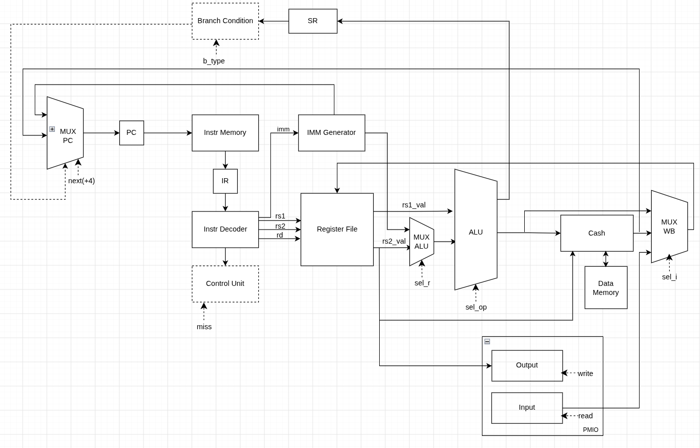
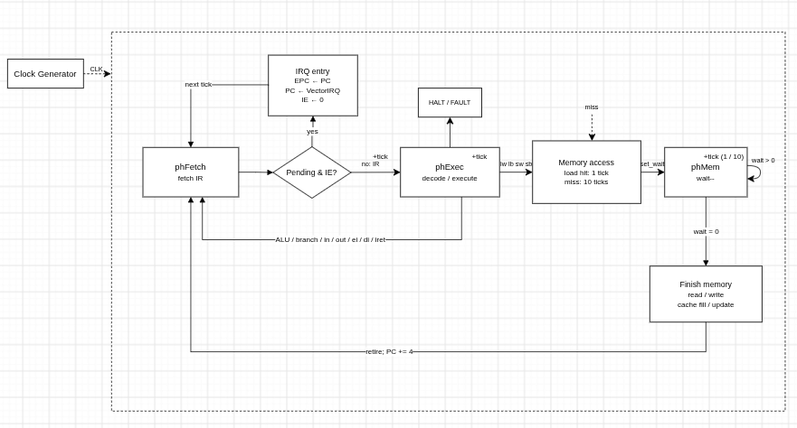

# Lisp-транслятор и модель RISC-процессора

Нестерович Елизавета Боевна, группdrow io19
Вариант: `lisp | risc | harv | hw | trap | port | cstr | cache | alg1`

Примечания к варианту:

cache: попадание 1 такт, обращение к памяти 10 тактов.
alg1: `is_prime`, `format_string`.

## Содержание

- [Язык программирования](#язык-программирования)
- [Организация памяти](#организация-памяти)
- [Система команд](#система-команд)
- [Транслятор](#транслятор)
- [Модель процессора](#модель-процессора)
- [Тестирование](#тестирование)
- [Ограничения и упрощения](#ограничения-и-упрощения)

## Язык программирования

### Синтаксис

```ebnf
<программа>     ::= <форма> { <форма> }
<форма>         ::= <defun> | <interrupt> | <выражение>

<выражение>     ::= <атом> | "(" <операция> ")"
<атом>          ::= <число> | <идентификатор> | <строка>

<операция>      ::= <setq> | <арифметика> | <сравнение> | <if> | <while> | <progn> | <print> | <puts> | <in> | <out> | <флаг> | <память> | <вызов>

<setq>          ::= "setq" <идентификатор> <выражение>
<арифметика>    ::= <ариф_знак> <выражение> <выражение>
<ариф_знак>     ::= "+" | "-" | "*" | "/" | "%"
<сравнение>     ::= <срав_знак> <выражение> <выражение>
<срав_знак>     ::= "==" | "!=" | "<" | "<=" | ">" | ">="

<if>            ::= "if" <выражение> <выражение> [ <выражение> ]
<while>         ::= "while" <выражение> { <выражение> }
<progn>         ::= "progn" { <выражение> }

<print>         ::= "print" <выражение> { <выражение> }
<puts>          ::= "puts" <выражение>
<in>            ::= "in" <число>
<out>           ::= "out" <число> <выражение>
<флаг>          ::= "ei" | "di"
<память>        ::= ( "load" | "loadb" ) <выражение>
                  | ( "store" | "storeb" ) <выражение> <выражение>

<defun>         ::= "(" "defun" <идентификатор> "(" { <идентификатор> } ")" <выражение> { <выражение> } ")"
<interrupt>     ::= "(" "interrupt" { <выражение> } ")"
<вызов>         ::= <идентификатор> { <выражение> }

<идентификатор> ::= любая последовательность символов без пробелов, скобок и кавычек,
                    не являющаяся числом (например, is-prime, read_int)
<число>         ::= [ "-" ] <цифра> { <цифра> }
<строка>        ::= '"' { <символ> | <экранирование> } '"'
<экранирование> ::= "\n" | "\t" | "\\" | "\"" | реальный перевод строки
```

`defun` и `interrupt` допустимы только на верхнем уровне. Номера портов в `in` и `out` обязаны быть числовыми литералами. Комментарии не поддерживаются.

### Семантика

**Типизация.** Типов нет. Всё это 32-битное знаковое слово. Строка это адрес её первого байта, символ это число 0..255. Поэтому `(print 65)` выводит символ `A`, а не число. Для вывода числа цифрами пишется функция (пример `print-int` ниже).

**Литералы.**
- Целые в диапазоне 32-битного знакового числа.
- Строки с экранированием (`\n`, `\t`, `\\`, `\"`, а также реальный перевод строки внутри кавычек). Одинаковые литералы хранятся один раз и имеют один адрес.

**Области видимости.**
- Переменная, созданная `setq` вне функции, глобальная.
- Внутри функции параметры и переменные, созданные в ней `setq`, локальные (живут в кадре на стеке). `setq` по имени, которое уже есть среди локальных или глобальных, пишет в него.
- Тела функций компилируются после основной программы, поэтому глобальные переменные, созданные в ней, видны в функциях независимо от порядка форм. Чтение необъявленной переменной это ошибка компиляции.
- Обработчик прерывания видит только глобальные переменные.

**Функции.** `(defun f (a b) тело...)`, не более 8 параметров, рекурсия поддерживается. Имена встроенных форм зарезервированы. Из обработчика прерывания вызывать функции нельзя.

**Прерывания.** `(interrupt тело...)` описывает обработчик. Он вызывается процессором, когда приходит символ, и вручную не вызывается. Прерывания разрешаются и запрещаются формами `(ei)` и `(di)`, после сброса они запрещены.

### Примеры

Вывод строки:

```lisp
(print "Hello, world!\n")
```

Рекурсия:

```lisp
(defun fib (n)
  (if (< n 2)
      n
      (+ (fib (- n 1)) (fib (- n 2)))))
(print (+ 48 (fib 7)))
```

Вывод числа цифрами:

```lisp
(defun print-int (n)
  (if (< n 0)
      (progn (out 1 45) (print-int (- 0 n)))
      (progn
        (if (> n 9) (print-int (/ n 10)))
        (out 1 (+ 48 (% n 10))))))
```

`cat` на прерываниях с кольцевым буфером:

```lisp
(setq head 0)
(setq tail 0)
(setq qbuf "q               ")

(interrupt
  (storeb (+ qbuf tail) (in 0))
  (setq tail (% (+ tail 1) 16)))

(ei)
(setq c 1)
(while c
  (while (== head tail))
  (setq c (loadb (+ qbuf head)))
  (setq head (% (+ head 1) 16))
  (if c (out 1 c)))
```

## Организация памяти

Гарвардская архитектура, адресация байтовая, одно слово 32 бита.

Registers (32 x 32 bit): zero ra sp t0-t6 a0-a7 s1-s6

```
Instruction memory (байтовые адреса, шаг 4)
+--------------------------------------+
| 0x00 : j main                        |  вектор сброса
| 0x04 : j irq_handler                 |  вектор прерывания
| 0x08 : sp <- 8192, код программы     |
|        halt                          |
|        функции (defun)               |
|        обработчик прерывания, iret   |
+--------------------------------------+

          Data memory (8192 байта)
+--------------------------------------+
| 0x0000 : глобальные переменные       |  по 4 байта, выровнены
|          строковые литералы (cstr)   |  байты + 0
|   ...    свободно                    |
|   ...    стек                        |
| 0x2000 : начальное значение sp       |
+--------------------------------------+
```

Статические данные занимают не более 4096 байт снизу, под стек зарезервированы верхние 4096 байт. Стек и данные не пересекаются, пока `sp` не опустится ниже конца секции данных: модель при этом останавливается с ошибкой `stack overflow`.

**Размер доступа.** `lw`, `sw` требуют выравнивания на 4 байта, `lb`, `sb` работают с любым адресом. Порядок байт little-endian.

**Обработчик прерывания** использует только регистры `s1`-`s6`, поэтому регистры основной программы (`t0`-`t6`) не портит. Аппаратного сохранения контекста нет, кроме адреса возврата в `EPC`.

## Система команд

Классификация: RISC, load/store, команды фиксированной длины 32 бита, регистр-регистр.

### Особенности процессора

- 32 регистра по 32 бита (5-битный номер в команде), `zero` всегда ноль. Имена по ABI RISC-V. Используются только `zero`, `ra`, `sp`, `t0`-`t6`, `a0`-`a7`, `s1`-`s6`. Указатель кадра (`fp`/`s0`) и `gp` не нужны: кадр адресуется от `sp`, глобальные переменные абсолютным адресом от `zero`.
- Арифметика 32-битная знаковая, переполнение циклическое.
- Данные в памяти только через `lw`, `lb`, `sw`, `sb`. Адрес равен `rs1 + imm`.
- Порты ввода-вывода (port-mapped): порт 0 регистр данных входного устройства, порт 1 вывод одного символа. Номер порта кодируется в поле константы.
- Переходы: условные по значениям регистров и безусловные, смещение относительно `pc` в байтах (`k = target - pc`).
- Прерывания: одна линия, вектор по адресу 4, регистр `EPC`, флаги `IE` и `Pending`.

### Набор инструкций

Каждая инструкция начинается с фазы FETCH (1 такт) и выполняется в фазе EXEC (1 такт). Команды доступа к памяти ждут дополнительные такты (1 при hit, 10 при miss).

| Инструкция | Синтаксис | Операция | Тактов |
|---|---|---|---|
| `add sub mul div rem` | `add rd, rs1, rs2` | `rd <- rs1 op rs2`. `div` на 0 даёт -1, `rem` на 0 даёт `rs1` | 2 |
| `addi` | `addi rd, rs1, imm` | `rd <- rs1 + imm` | 2 |
| `lui` | `lui rd, imm` | `rd <- imm << 16` | 2 |
| `lw` | `lw rd, imm(rs1)` | чтение слова | 2 + (1 | 10) |
| `lb` | `lb rd, imm(rs1)` | чтение байта без знакового расширения | 2 + (1 | 10) |
| `sw` | `sw rs, imm(rs1)` | запись слова (write-through) | 12 |
| `sb` | `sb rs, imm(rs1)` | запись байта (write-through) | 12 |
| `beq bne blt bge bltu` | `blt rs1, rs2, addr` | переход, если условие выполнено | 2 |
| `beqz` | `beqz rs1, addr` | переход, если `rs1 == 0` | 2 |
| `j` | `j addr` | безусловный переход | 2 |
| `jal` | `jal rd, addr` | `rd <- pc + 4`, переход | 2 |
| `jalr` | `jalr rd, rs1, imm` | `rd <- pc + 4`, `pc <- rs1 + imm` | 2 |
| `in` | `in rd, port` | чтение порта, регистр данных освобождается | 2 |
| `out` | `out rs, port` | запись регистра в порт | 2 |
| `ei`, `di` | | разрешить, запретить прерывания | 2 |
| `iret` | | `pc <- EPC`, прерывания разрешены | 2 |
| `halt` | | остановка | 2 |
| вход в прерывание | не инструкция | `EPC <- pc`, `pc <- 4`, `IE <- 0` | 1 |

Компилятор не выдаёт `bltu`, она оставлена для арифметики двойной точности (перенос при сложении 64-битных чисел).

### Кодирование

Каждая инструкция занимает 32 бита, старшие 6 - опкод:

```
N: [op:6][............ не используется ............]      halt ei di iret
R: [op:6][rd:5][rs1:5][rs2:5][......... 0 .........]     add sub mul div rem
I: [op:6][rd:5][rs1:5][............ imm:16 ..........]   addi lui lw lb sw sb jalr in out
B: [op:6][rs1:5][rs2:5][........... disp:16 .........]   beq bne blt bge bltu beqz
J: [op:6][rd:5][................ disp:21 ..............]  j jal
```

Особенности:
- В `sw`, `sb`, `out` поле `rd` содержит регистр-источник.
- `imm` и `disp` знаковые.
- Константа 32 бит собирается как `lui` (старшие 16) и `addi` (младшие 16).

| Опкод | Инструкция | Опкод | Инструкция | Опкод | Инструкция |
|---|---|---|---|---|---|
| 0 | halt | 9 | addi | 18 | beq |
| 1 | ei | 10 | lui | 19 | bne |
| 2 | di | 11 | lw | 20 | blt |
| 3 | iret | 12 | lb | 21 | bge |
| 4 | add | 13 | sw | 22 | bltu |
| 5 | sub | 14 | sb | 23 | beqz |
| 6 | mul | 15 | jalr | 24 | j |
| 7 | div | 16 | in | 25 | jal |
| 8 | rem | 17 | out | | |

### Бинарный файл

```
[ "AAL1" ][ размер кода, байт ][ размер данных, байт ][ слова кода ][ данные ]
  4 байта        4 байта              4 байта          по 4 байта     байты
```

Числа в little-endian. Рядом с бинарником транслятор создаёт текстовый листинг `<имя>.hex` формата `<адрес> - <HEX> - <мнемоника>` и дамп секции данных. Листинг получается декодированием уже записанных слов, то есть показывает реальное содержимое файла.

## Транслятор

### Интерфейс

Запуск: `go run ./cmd/translator`. Параметры берутся из `config.json`:

| Поле | Значение |
|---|---|
| `source_file` | список файлов с исходным кодом |
| `target_dir` | каталог для бинарников и листингов |
| `input_file` | список файлов ввода (для модели, по одному на программу) |
| `input_first_tick` | такт прихода первого символа |
| `input_period` | период прихода символов в тактах |
| `cache_off` | `true` отключает кэш |

Файлы транслируются параллельно (кол-во горутин опционально, defoult: 5). Код возврата 1, если файл не оттранслирован.

### Этапы

1. Лексер (`lexer`): разбивает текст на токены `(`, `)`, атомы и строковые литералы целиком (с учётом `\"`).
2. Парсер (`parser`): строит дерево из вложенных списков (`[]any`), атомы это числа, идентификаторы и строки (`parser.Str`).
3. Кодогенерация (`codegen`): рекурсивный обход дерева, результат каждого выражения оказывается в регистре, переданном вызывающим.
4. Ассемблер (`isa.Assemble`): кодирование в слова, запись бинарника и листинга.

## Модель процессора

### Интерфейс

Для каждой программы из конфига печатаются вывод, число тактов и инструкций, счётчики кэша и потерянных символов. Журнал пишется в отдельный файл на каждую программу.

### PC



### ControlUnit


### Устройство управления

Hardwired, конечный автомат с тремя фазами. Метод `Cycle()` выполняет ровно один такт, поэтому моделирование можно остановить после любого такта.

| Фаза | Что происходит | Тактов |
|---|---|---|
| FETCH | проверка запроса прерывания, чтение команды из памяти команд | 1 |
| EXEC | ALU, переход, обращение к порту, расчёт адреса, запись в регистр | 1 |
| MEM | ожидание данных (только `lw`, `lb`, `sw`, `sb`) | 1 при hit, 10 при miss |

### Ввод-вывод и прерывания

**Ввод.** Модель получает расписание `(такт, символ)`. Файл ввода раскладывается по тактам: первый символ приходит на такте `input_first_tick`, дальше с шагом `input_period`. В конец расписания добавляется символ с кодом 0 (признак конца ввода). Когда такт наступает, символ попадает в регистр данных (порт 0) и поднимается запрос прерывания.

**Вывод.** Инструкция `out` с портом 1 добавляет байт в буфер вывода, в конце моделирования буфер печатается.

**Прерывание.**
1. Запрос запоминается в защёлке `Pending` (один бит). Устройство опрашивается каждый такт.
2. Если `Pending` и `IE`, то в фазе FETCH процессор входит в прерывание: `EPC <- PC`, `PC <- 4`, `IE <- 0`, `Pending <- 0`. Это занимает 1 такт. Прерывание принимается только на границе инструкций.
3. Обработчик выполняет `in` (читает символ и освобождает регистр данных) и записывает его в память.
4. `iret` возвращает `PC <- EPC` и разрешает прерывания.

> В обработчике `IE = 0`, поэтому вложенность невозможна. Новый запрос запоминается в `Pending` и обрабатывается сразу после `iret`. Если за это время придёт ещё символ, а предыдущий не прочитан, регистр данных перезаписывается: потеря символа считается счётчиком `overruns` и пишется в журнал (`OVERRUN`).

### Кэш данных

- Полностью ассоциативный, 8 линий по одному слову.
- Вытеснение FIFO с явным указателем.
- Запись: write-through, no-write-allocate. Запись всегда идёт в память (10 тактов), кэш обновляется только если слово там уже есть.
- Чтение: попадание 1 такт, промах 10 тактов с заполнением линии.
- Кэшируются только данные, память команд отдельная и обращений к ней за пределами фазы FETCH нет.
- В журнале видно `HIT` / `MISS`, шаги ожидания (`WAIT mem k/10`) и заполнение линии (`CACHE fill line ...`).

Влияние кэша (программа `linear_filter`, заполни своими числами):

| | Такты | Попадания | Промахи |
|---|---|---|---|
| Без кэша (`cache_off: true`) | TODO | 0 | TODO |
| С кэшем | TODO | TODO | TODO |

### Журнал

Формат строки: `TICK <такт> PC <адрес> [main|irq ] <событие>`. События:

```
FETCH  addi t0, zero, 0
MEM    lw addr=8188 MISS, 10 tick(s)
WAIT   mem 3/10
CACHE  fill line 3 addr=8188 (evicted valid=false addr=0)
RETIRE lw t1, 32(sp) | sp=8156 t1=57 IE=true
IRQ raised (data='7')
ENTER interrupt, epc=444
LEAVE interrupt
```

Метка `[irq ]` показывает, что процессор работает в обработчике. В строке `RETIRE` печатаются ненулевые регистры и флаг `IE`.

### Остановка моделирования

- по `halt`;
- по ошибке: выход `PC` за память команд, неверный адрес данных, переполнение стека (`FAULT` в журнале и в выводе);
- по лимиту тактов.

## Тестирование

TODO: описать тесты после реализации golden-тестов. Запуск: `go test ./...`, обновление эталонов: `go test ./... -update`.

Нужные golden-тесты (каждый один файл YAML: исходник, ввод, машинный код с мнемониками, журнал, вывод):

| Тест | Что проверяет |
|---|---|
| `hello` | cstr в секции данных, вывод строки |
| `cat` | ввод через прерывания, кольцевой буфер, конец ввода |
| `hello_user_name` | ввод строки, приветствие |
| `sort` | массив в памяти, сравнения, циклы |
| `double_precision` | 64-битное сложение на 32-битных словах |
| `is_prime` | алгоритм alg1: разбор числа, цикл, остаток |
| `format_string` | алгоритм alg1: `%d`, `%5d`, `%-5d` |
| `linear_filter` | влияние кэша на такты |
| `recursion` | `fact`, `fib`, стек, сохранение регистров |
| `expressions` | «всё есть выражение»: `(print (setq x 13))` и подобное |
| `irq_overrun` | потеря символа при быстром вводе |

CI: TODO (ссылка на отчёт, `gofmt`, `go vet`, `golangci-lint`, `go test`).

Пример использования:

```
$ go run ./cmd/translator
$ go run ./cmd/machine
> test/is_prime.lisp
Output: "1"
Ticks: ..., instructions: ..., overruns: 0, cache: enabled=true hits=... misses=...
```

## Ограничения и упрощения

- Нет комментариев и типов, число и символ неразличимы.
- `print` выводит число одним байтом (как символ), цифрами число печатается функцией на lisp.
- Не более 8 параметров функции.
- Функции нельзя вызывать из обработчика прерывания.
- `format_string`: при ошибке выводится текст `-1`, остаток входа не возвращается, одиночный `%` без `d` выводится как обычный символ. Строка формата до 32 символов, до 16 спецификаторов.
- Декодирование команд выполняется один раз при загрузке бинарника, поэтому процессор получает уже разобранные инструкции. Побитовый формат при этом реальный.
